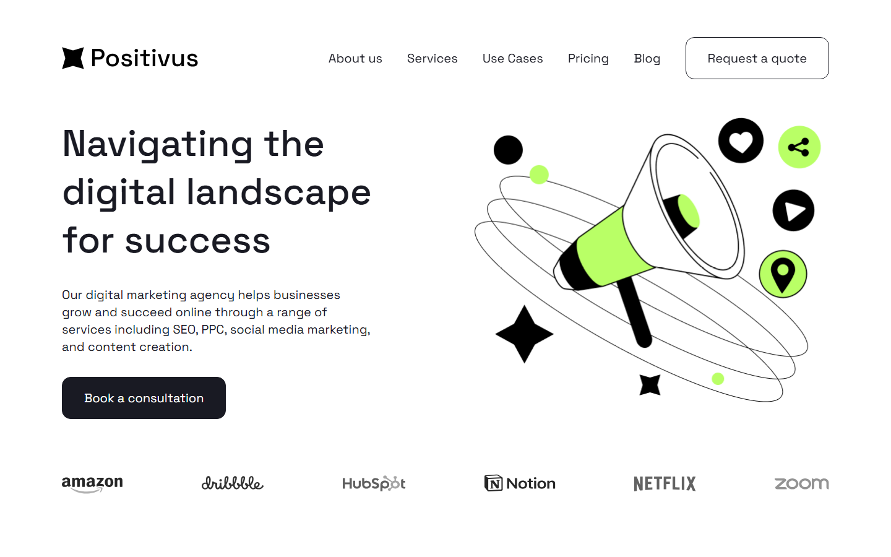

# Positivus: digital marketing agency landing page

A responsive landing page coded from a free Figma design. This is a practice project made to show my front-end work: pixel-accurate layout, a mobile version, and small interactions without any framework.

## What is inside

- Header with a mobile burger menu
- Hero, client logos, services cards, call-to-action block
- Case studies and an accordion "Working process"
- Team cards and a testimonials slider (arrows and dots)
- Contact form and footer
- Smooth reveal on scroll and hover effects (can be turned off with `prefers-reduced-motion`)

## Tech

HTML, CSS (grid, flexbox, custom properties) and vanilla JavaScript. No libraries. Font: Space Grotesk (Google Fonts).

## Screenshots

| Desktop (1440 px) | Mobile (375 px) |
|---|---|
| [desktop-full.png](screenshots/desktop-full.png) | [mobile-full.png](screenshots/mobile-full.png) |

## Run it

Open `index.html` in a browser. No build step is needed.

## What I did and what I added

- Coded the desktop design from the Figma file.
- The design had no mobile version, so I made the responsive layout myself (breakpoints at 1100 px and 820 px).
- Added animations, the accordion and slider logic, and the mobile menu.
- Wrote the text of the collapsed process steps (02–06), which are not visible in the design.
- The contact and subscribe forms are for show: nothing is sent.

## Credits and license

- Design: [Positivus Landing Page Design](https://www.figma.com/community/file/1230604708032389430/positivus-landing-page-design) by [Olga](https://www.figma.com/@olgaaverchenko), licensed under [CC BY 4.0](https://creativecommons.org/licenses/by/4.0/). I converted the design to code and added a mobile layout and animations.
- Illustrations by Igor Kapustin; image by vectorjuice on Freepik (as credited in the original design).
- Code in this repository: written by Arina.
